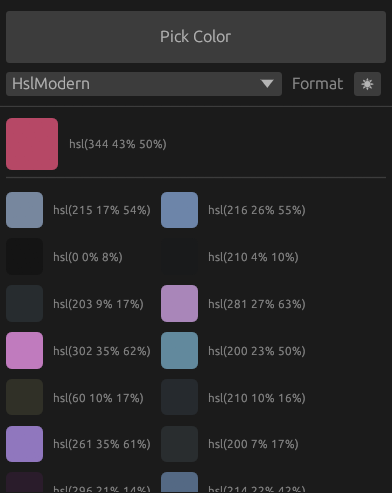

# niri-colorpicker
A color picker for the [niri](https://github.com/YaLTeR/niri) Wayland compositor

## Features
- Pick colors using niri's built-in `pick-color` command
- Copy colors in multiple formats: HEX, RGB, HSL, RGB Modern, HSL Modern
- Edit colors with a built-in color wheel (right-click a swatch)

## Requirements
- `wl-clipboard` (provides `wl-copy`)

## Download
[Linux](https://github.com/plucafs/niri-colorpicker/releases)

## Credits
- [OpenCode](https://github.com/anomalyco/opencode)

## License
MIT